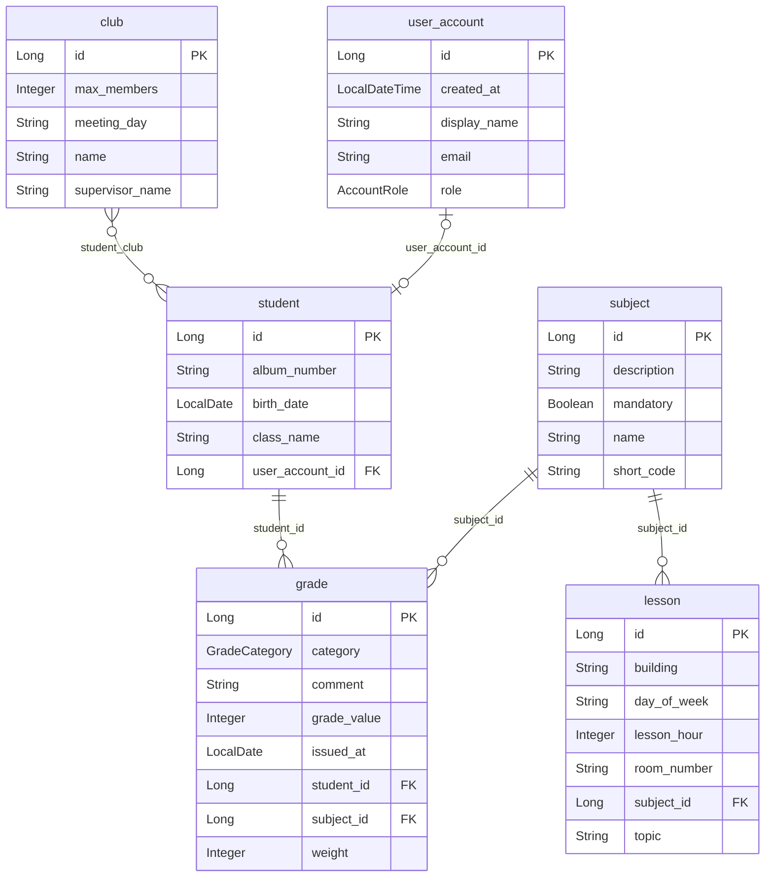

# Schemat bazy danych

Plik generują reguły projektu (panel Maven → Lifecycle → verify). Nie edytujcie go ręcznie.

Tabele: 7 (w tym tabele łączące @ManyToMany: student_club) · kolumny: 35 · relacje: 3 × @ManyToOne, 2 × @OneToMany, 1 × @OneToOne, 1 × @ManyToMany

| Tabela | Encja | Kolumny | Klucze obce |
|---|---|---|---|
| club | Club | 5 | — |
| grade | Grade | 8 | student_id, subject_id |
| lesson | Lesson | 7 | subject_id |
| student | Student | 5 | user_account_id |
| subject | Subject | 5 | — |
| user_account | UserAccount | 5 | — |

